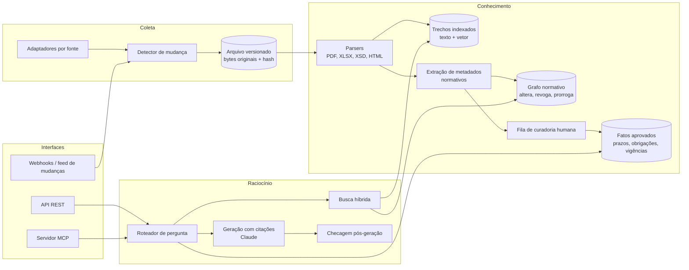

# Arquitetura

## 1. Visão geral

A plataforma tem quatro blocos. O LLM fica só no fim da cadeia: a confiabilidade vem do que acontece antes dele (coleta, arquivo versionado, fatos curados) e da checagem depois dele.



## 2. Componentes

### 2.1 Coleta (worker)

- **Um adaptador por fonte**, declarado em configuração: URL base, padrão de links a seguir, frequência, nível de autoridade (N1–N3, ver [FONTES-OFICIAIS.md](FONTES-OFICIAIS.md)).
- Adaptadores previstos: páginas gov.br (Plone: Portal NFS-e, Receita Federal, Fazenda), Planalto (incluindo republicações e retificações), DOU, base de normas da Receita (SIJUT), cgibs.gov.br, Portal NF-e.
- **Barreira de origem**: lista fechada de domínios e órgãos oficiais aplicada no coletor *e* de novo na gravação do *snapshot*. Links de páginas oficiais que apontam para fora da lista não são seguidos. Qualquer documento fora da lista é rejeitado e gera alerta.
- **Detecção de mudança**: requisição condicional (ETag/Last-Modified) e comparação de SHA-256 do conteúdo. Mudou → novo *snapshot*, nunca sobrescrita.
- **Arquivo versionado**: bytes originais em storage de objetos (S3-compatível) + metadados no Postgres. Isso permite responder "o que a NT 009 dizia em 15/08/2026?" e provar a origem de qualquer citação.
- **Boas práticas de coleta**: respeitar robots.txt, limite de requisições por domínio, User-Agent genérico identificando o robô (sem dados pessoais), backoff em erro.
- Cada mudança gera um **evento de mudança** (documento novo, nova versão, documento removido), que alimenta o feed "o que mudou" e os webhooks. Esse feed já é um produto útil antes de existir qualquer IA.

### 2.2 Processamento de documentos

| Formato | Tratamento | Por quê |
|---|---|---|
| PDF (NTs, resoluções) | Extração de texto **com número de página** e estrutura de seções | Citações precisam apontar página e seção |
| XLSX (Anexos VI, VII, VIII) | Convertido em **tabelas estruturadas** (linha = registro) | Perguntas sobre códigos (cClassTrib, NBS, indOp, item da LC 116) são consultas exatas, não busca semântica |
| ZIP de XSD | Dicionário de campos: nome, tipo, obrigatoriedade, descrição, versão do leiaute | Ferramenta "explicar campo" com resposta exata e versionada |
| HTML (notícias, leis) | Limpeza, preservação de artigos/parágrafos/incisos em leis | Citar "art. 62, § 3º" e não "em algum lugar da página" |

Trechos (*chunks*) respeitam a estrutura do documento (artigo, seção da NT, regra de validação) em vez de cortes por tamanho fixo.

### 2.3 Extração de metadados normativos e curadoria

Para cada documento novo, o Claude extrai em formato estruturado (*structured outputs*): tipo do ato, número, data, órgão emissor, datas de vigência, cronogramas citados e relações com outros atos (altera / revoga / prorroga / regulamenta).

- **Relações** vão para o **grafo normativo**, que responde "isso ainda vale?".
- **Fatos de alto impacto** (prazo de obrigatoriedade, data de entrada em produção, revogação) entram como *propostos* numa **fila de curadoria**. Um curador humano aprova com um clique, vendo o trecho original ao lado. Só fatos aprovados são usados para declarar algo FALSO ou DESATUALIZADO.
- Motivo: um erro de extração num prazo vira um "fake" errado com a marca da plataforma. Esse é o maior risco de reputação do produto, e a revisão humana custa poucos minutos por documento.

### 2.4 Busca

Busca **híbrida**, porque nesse domínio boa parte das perguntas cita identificadores exatos ("NT 009", "indFinal", "cClassTrib 000001"):

1. **Léxica**: full-text do Postgres com dicionário português + `unaccent` + trigramas para códigos.
2. **Semântica**: vetores (pgvector) para perguntas em linguagem natural.
3. **Fusão** (Reciprocal Rank Fusion) e **filtros**: nível de autoridade, vigência na data perguntada, tipo de documento.
4. **Expansão pelo grafo**: se um trecho de um ato revogado volta na busca, o ato que o revogou entra junto.

### 2.5 Roteador de pergunta

Classifica a pergunta e escolhe o caminho mais determinístico possível:

| Tipo | Exemplo | Caminho |
|---|---|---|
| Código / tabela | "Qual cClassTrib para o item 1.05?" | Consulta nas tabelas estruturadas, resposta com linha e versão do anexo |
| Campo do leiaute | "O que é o campo indFinal?" | Dicionário XSD + trecho da NT |
| Prazo / cronograma | "Quando o Simples é obrigado a usar o emissor nacional?" | Fatos aprovados primeiro; busca só complementa |
| Conceitual | "Como a NFS-e se relaciona com o IBS?" | Busca híbrida + geração com citações |
| Verificação | "É verdade que…" | Pipeline de [verificação de alegações](VERIFICACAO-DE-ALEGACOES.md) |
| Fora do escopo | ISS (lei municipal, alíquota, apuração), consultoria tributária | Recusa explicando o limite e indicando onde procurar |

### 2.6 Geração com citações

- Modelo: `claude-opus-5-5`, thinking adaptativo, `effort` definido explicitamente por rota (o padrão desse modelo é `medium`).
- Os trechos recuperados vão para o modelo como blocos `search_result` com `citations: {enabled: true}`. A própria API devolve, para cada frase, o trecho citado e a origem. O modelo não precisa "lembrar" fontes, e não consegue inventar uma citação que não estava na entrada.
- Instruções do sistema: responder só com base nos resultados; dizer "não encontrei em fonte oficial" quando for o caso; separar o que vale hoje do que tem vigência futura; indicar conflitos entre fontes.
- *Prompt caching* no prompt de sistema e nas definições de ferramentas, que são fixos.
- `fallbacks` do lado do servidor habilitado para tratar recusas do modelo sem derrubar a requisição.
- Conteúdo dos documentos e textos enviados por usuários são tratados como **dados**, nunca como instrução (defesa contra *prompt injection* em PDFs ou posts colados).

### 2.7 Checagem pós-geração (determinística, sem LLM)

Antes de devolver a resposta:

1. Toda frase factual tem pelo menos uma citação. Frase factual sem citação é removida ou a resposta é rejeitada.
2. Cada citação aponta para um *snapshot* arquivado com hash conhecido, de domínio e órgão da lista oficial.
3. Afirmação sobre prazo ou obrigação precisa de citação N1 ou N2; se só houver N3, a resposta ganha aviso explícito.
4. Se o *snapshot* citado está mais velho que o SLA de atualização da fonte, a resposta avisa ("fonte verificada pela última vez em…").
5. Se a citação é de ato marcado como revogado/alterado no grafo, a resposta é rejeitada e regenerada com o ato vigente.

### 2.8 Formato da resposta

```json
{
  "resposta": "texto com marcadores de citação [1], [2]",
  "posicao_em": "2026-11-16",
  "fontes": [
    {
      "id": 1,
      "titulo": "Nota Técnica SE/CGNFS-e nº 009",
      "orgao": "SE/CGNFS-e",
      "nivel": "N2",
      "versao": "1.01",
      "data_documento": "2026-10-01",
      "url": "https://www.gov.br/nfse/...",
      "trecho": "…texto exato citado…",
      "pagina": 12,
      "coletado_em": "2026-11-16T08:00:00-03:00",
      "sha256": "…",
      "situacao": "vigente"
    }
  ],
  "conflitos": [],
  "limites": ["Não cobre ISS (legislação municipal, alíquotas, apuração) nesta versão."],
  "aviso": "Informação baseada em fontes oficiais; não substitui orientação profissional."
}
```

## 3. Modelo de dados (Postgres)

| Tabela | Campos principais |
|---|---|
| `fonte` | id, nome, órgão, nível (N1–N3), dominios_permitidos, url_base, adaptador, frequência, sla_atualizacao |
| `documento` | id, fonte_id, url_canonica, tipo (lei, resolução, NT, anexo, XSD, notícia, FAQ), número, título, órgão_emissor, data_publicacao |
| `snapshot` | id, documento_id, coletado_em, sha256, mime, chave_storage, etag, texto_extraido, versao_declarada |
| `trecho` | id, snapshot_id, ordem, texto, pagina_ini/fim, caminho_secao, tsvector, embedding |
| `relacao_normativa` | origem_id, destino_id, tipo (altera, revoga, prorroga, regulamenta, cita), dispositivo, evidencia_trecho_id |
| `fato` | id, enunciado, tipo (prazo, obrigação, vigência, valor), vigente_de/ate, status (proposto, aprovado, superado), evidencias[], aprovado_por, aprovado_em |
| `tabela_referencia` / `linha_referencia` | Conteúdo estruturado dos anexos XLSX, com versão do anexo |
| `campo_leiaute` | nome, caminho XPath, tipo, obrigatoriedade, descrição, versão do leiaute, NT de origem |
| `evento_mudanca` | id, documento_id, snapshot_anterior, snapshot_novo, tipo, resumo, detectado_em |
| `verificacao` | id, entrada, alegacoes[], vereditos[], criada_em, link público permanente |
| `consulta_log` | pergunta, rota, fontes usadas, latência, custo, feedback do usuário |

O identificador público de um *snapshot* (`documento + sha256`) é estável: qualquer citação emitida hoje continua resolvível no futuro.

## 4. Interfaces

### 4.1 API REST

| Método | Rota | Função |
|---|---|---|
| POST | `/v1/perguntas` | Pergunta em linguagem natural → resposta com fontes |
| POST | `/v1/verificacoes` | Texto ou link de alegação → vereditos por alegação |
| GET | `/v1/verificacoes/{id}` | Verificação salva (link compartilhável) |
| GET | `/v1/busca` | Trechos oficiais brutos, sem geração |
| GET | `/v1/documentos/{id}` e `/v1/documentos/{id}/snapshots` | Documento, histórico de versões, download do original |
| GET | `/v1/mudancas?desde=` | Feed de mudanças nas fontes oficiais |
| GET | `/v1/fatos?tema=` | Fatos aprovados (prazos, obrigações) com evidência |
| GET | `/v1/referencias/{tabela}?codigo=` | Consulta exata em tabelas oficiais (cClassTrib, NBS, indOp…) |
| GET | `/v1/leiaute/campos/{nome}?versao=` | Definição de campo do leiaute |
| POST | `/v1/webhooks` | Assinatura de alertas (nova NT, novo prazo, alteração de fato) |

Autenticação por chave de API por cliente, limite de requisições e medição de uso por chave. Especificação OpenAPI gerada a partir dos schemas Zod.

### 4.2 Servidor MCP

Exposto em Streamable HTTP (remoto, com autenticação) e stdio (uso local). Ferramentas:

| Ferramenta | Retorno |
|---|---|
| `perguntar_nfse` | Resposta pronta com citações (usa o pipeline completo) |
| `verificar_alegacao` | Vereditos por alegação, com evidências |
| `buscar_fontes_oficiais` | Trechos brutos com metadados, para o LLM do cliente raciocinar |
| `obter_documento` | Documento/snapshot específico |
| `listar_mudancas` | Mudanças desde uma data |
| `consultar_prazo` | Fatos aprovados sobre prazos/cronogramas |
| `consultar_codigo` | Linha exata de tabela oficial |
| `explicar_campo_leiaute` | Definição versionada de campo |

Recursos MCP: `nfse://fontes`, `nfse://documento/{id}`, `nfse://mudancas/recentes`.

Ferramentas que devolvem **evidência bruta** (`buscar_fontes_oficiais`, `consultar_codigo`) permitem que o agente do cliente use os dados sem depender da nossa geração. Ferramentas que devolvem **resposta pronta** dão a garantia completa de citação e checagem.

## 5. Stack

| Camada | Escolha | Observação |
|---|---|---|
| Linguagem / runtime | TypeScript, Node.js 24 | Decidido |
| Monorepo | pnpm workspaces | `apps/api`, `apps/mcp`, `apps/worker`, `apps/admin` (curadoria); `packages/core`, `ingest`, `retrieval`, `llm`, `db` |
| HTTP | Fastify + Zod | OpenAPI gerado dos schemas |
| MCP | `@modelcontextprotocol/sdk` | Streamable HTTP + stdio |
| LLM | `@anthropic-ai/sdk`, `claude-opus-5-5` | Citações via `search_result`; *structured outputs* para extração e vereditos; Batches API (50% do custo) para processar o acervo histórico na carga inicial |
| Banco | PostgreSQL + pgvector + `unaccent` + `pg_trgm` | Um único banco para relacional, full-text e vetores |
| Filas | pg-boss | Usa o próprio Postgres; um serviço a menos |
| Storage | S3-compatível (MinIO local, S3/R2 em produção) | Bytes originais dos documentos |
| Parsing | pdf.js (`unpdf`), ExcelJS, parser XML, Cheerio | Playwright só se alguma fonte exigir JavaScript |
| Embeddings | **Decisão em aberto** — a Anthropic não oferece modelo de embeddings | Opções: Voyage AI (API) ou modelo multilíngue auto-hospedado |
| Observabilidade | OpenTelemetry + logs estruturados | Custo e latência por rota |
| Local | Docker Compose | Postgres, MinIO, serviços |

Observação técnica: na API do Claude, citações (`citations`) e saída estruturada (`output_config.format`) **não podem ser usadas na mesma requisição**. Por isso as respostas em texto usam citações nativas, e os vereditos (JSON) carregam IDs e trechos de evidência no próprio schema, verificados deterministicamente depois (ver [VERIFICACAO-DE-ALEGACOES.md](VERIFICACAO-DE-ALEGACOES.md)).

## 6. Segurança, privacidade e responsabilidade

O detalhamento completo está em [SEGURANCA.md](SEGURANCA.md): modelo de ameaças, XSS, CORS/CSRF, mapeamento OWASP (Top 10:2025, API Security 2023, LLM 2025), MCP, SSRF no coletor e nos webhooks, cadeia de suprimentos, LGPD e requisitos por fase. Resumo das decisões que afetam a arquitetura:

- **Falhar fechado**: qualquer checagem que falhe impede a resposta.
- **LLM sem agência**: nenhuma ferramenta com efeito colateral e nenhuma busca na web aberta. O modelo só vê trechos da base oficial. Texto colado pelo usuário nunca entra na base.
- **Regras de veredito em código**, não no prompt: uma prompt injection não consegue produzir um veredito que a checagem determinística não aprove.
- **Base imutável**: storage WORM, papel de banco do coletor só insere, alerta de anomalia em mudanças inesperadas.
- **Isolamento entre clientes** em toda consulta, com Row-Level Security como segunda camada.
- **Saída sanitizada**: a API devolve JSON; o front não renderiza HTML externo; a saída do LLM perde imagens e links fora da lista oficial.
- **Saídas para a rede controladas**: o coletor e os webhooks passam por proxy de egresso com bloqueio de redes internas.
- **LGPD**: retenção curta, minimização, tratamento da transferência internacional para o provedor de LLM.
- **Responsabilidade**: todo veredito e toda resposta carregam a data de posição e o aviso de que não substituem orientação profissional. A palavra "FALSO" só aparece com evidência N1/N2 contrária e fato aprovado por curador.
- **Rastreabilidade**: toda resposta é reproduzível a partir de `consulta_log` + *snapshots* citados.
